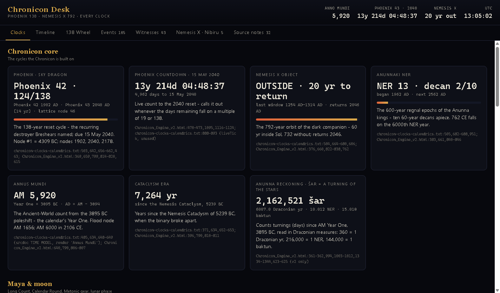

# Chronicon Desk

Every clock in the Chronicon engine, the Phoenix 138-year cycle, the witnesses, the events, Nemesis X and Nibiru on one
desktop timeline. React 19 + Vite inside Electron, shipped as a single portable Windows `.exe`.



## What's in it

| Tab | What it shows |
|---|---|
| **Clocks** | 30 live clocks ported from `Chronicon_Engine_v2.html`: Phoenix 138 (films' numbering, lattice node alongside), the 2040 countdown with the ×19/×138 day flags, Nemesis X 792 inside/outside, NER 600 and its decans, Anno Mundi, the Cataclysm era, Anunna turnings, Long Count baktun, Calendar Round, moon phase, Metonic year, Giza apparent solar time, Cairo, UTC, local, and the calendar wall (Hebrew, Coptic, Nabonassar, Sothic, Hijri, Persian, Saka, Ethiopic, sexagenary, Byzantine, Kali Yuga, Buddhist, Holocene, French Republican, JDN, Unix). Plus the period-only constants. |
| **Timeline** | Seven lanes: Phoenix dates, Nemesis X windows and passages, Nibiru, the Chronicon ledger, events, witnesses, Maya baktuns. Scroll to zoom, drag to pan, click for detail; faint gold dashes are Phoenix years. |
| **138 Wheel** | Every dated item folded onto one 138-year turn from Year One, with the 792-year Nemesis ring inside it. Phoenix-year alignments stack at the top. |
| **Events** | 105 events, searchable and filterable by tag, with AM and phase. |
| **Witnesses** | 43 witnesses with era, testimony and the events they speak to. |
| **Nemesis X · Nibiru** | Nemesis X, Phoenix, Nemesis, Electra and Nibiru with their past and next passages. |
| **Source notes** | 32 places where the source files disagree, kept visible instead of silently corrected. |

## Data

`src/data/clocks.json` and `src/data/phoenix.json` were extracted from the user's own repos:

- `NatorionCipherPredictiveEngine/chronicon-clocks-calendrics.txt`, `OPHIS-…/Chronicon_Engine_v2.html`,
  `natori-on-psyfr/chronicon.html` and `docs/` → clocks, bodies, the 82-row Chronicon ledger
- `phoenix-chronicles-tools/films/generators/*/stations.json`, `films/data/AllClips_*.json`, `codex/` → Phoenix 1–43,
  events, witnesses, projections
- Nibiru: `Chronotecture-Charts/redesign/vid.html` and `iic.html` (1254 entering, 1314 exiting)

Every record keeps a `source` pointer back to its file and line. Inside the app all years are **astronomical**
(1 BC = 0); `phoenix.json` stores N BC as −N and is shifted on load (`src/data.js`).

## Run and build

```bash
npm install
npm run dev          # browser preview at http://localhost:5173
npm start            # build + open in Electron
npm run dist         # build the portable exe into release/
```

**OneDrive:** electron-builder's final rename fails inside a OneDrive-synced folder (`EPERM … win-unpacked.tmp`).
Build to a local folder instead and copy the exe back:

```bash
npx vite build && npx electron-builder --win portable --config.directories.output="$LOCALAPPDATA/chronicon-desk-build"
```

npm 12 blocks install scripts by default; `package.json` allow-lists `electron` so its binary downloads. The exe is
unsigned, so SmartScreen may ask once.

Dev helpers: `npx electron scripts/shoot.cjs <dir>` screenshots every tab from the built app;
`npx electron scripts/icon.cjs` redraws `build/icon.png`.
